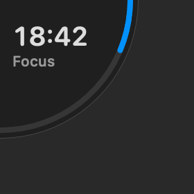
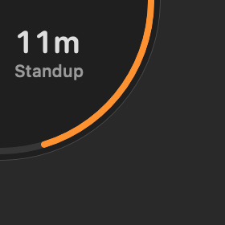
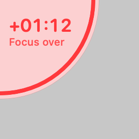
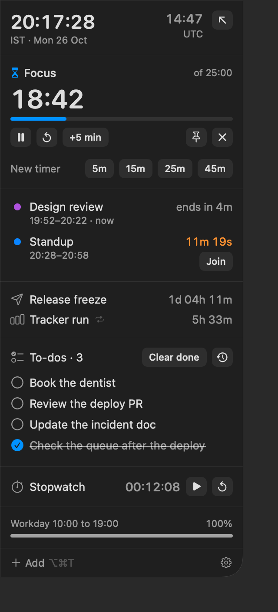
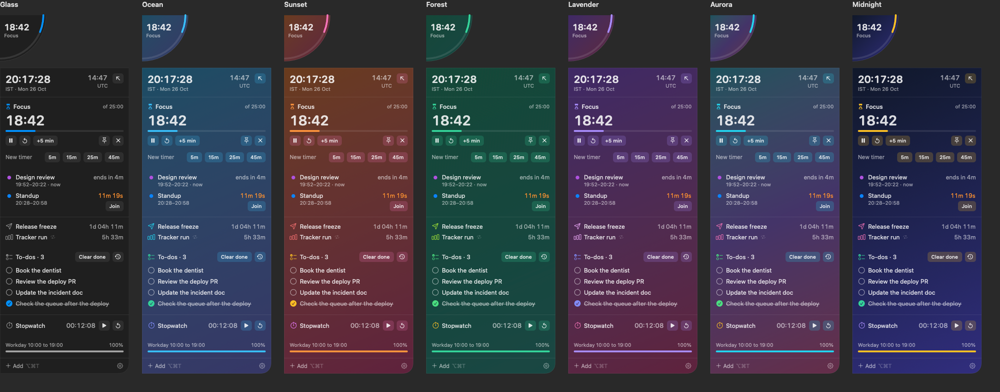

# Corner

A small macOS widget that sits in the top-left corner of the screen, just under the menu bar.
Minimized it's a quarter circle showing one thing; click it and it opens into a card with
clocks, timers, countdowns, a stopwatch and workday progress.

| Minimized | Meeting soon | Time's up | Open |
| --- | --- | --- | --- |
|  |  |  |  |

### Companions

Settings → Idle corner (or right-click the corner → When nothing's on) swaps the idle clock for a
companion: original pixel-art characters in the style of desktop mascots (a ninja, a swordsman, a
mage) and a cat. Whenever a timer, countdown, meeting or Claude session needs the corner, it takes
over as before.

- `CompanionBrain` (CornerKit) picks what it does: sits about, waves, does its own trick (throwing
  stars, sword practice, a spell, chasing yarn), paces up and down, climbs the side of the screen
  and goes hand over hand under the menu bar before dropping back down, naps after 5 minutes away
  from the keyboard (1 minute after midnight), stretches when you're back, and waves with hearts
  when the pointer is on the corner. Idle time comes from `CGEventSource`, which needs no permission.
- The art is text: `Views/CompanionSprites.swift` holds every sprite as rows of palette letters
  (shared bodies and heads, each character's hair and kit on top). `scripts/companion-preview.py`
  draws them to a PNG for working on the art; `Corner --snapshot` renders every move in
  `companions-*.png`.
- `Views/CompanionView.swift` scripts each activity as a loop of 56 × 56 frames and hands them to
  Core Animation, which plays them with hard pixel edges; the companion costs about 0.1% CPU.
  Redrawing through SwiftUI every frame cost 5 ms a frame, 4-9% of a core, all day.
- Reduce Motion shows a still frame per activity.

### Claude Code activity

Settings → Claude Code → **Set up…** adds six hooks (UserPromptSubmit, PostToolUse, Notification,
Stop, SubagentStop, SessionEnd) to `~/.claude/settings.json`, keeping everything else and saving
`settings.json.corner-backup`. **Remove…** takes out only Corner's entries.

- Each hook runs `~/Library/Application Support/Corner/claude-hook.sh`, which appends the event
  with a timestamp to `claude-events.jsonl` in the same folder and exits. It prints nothing (a
  UserPromptSubmit hook's output would land in Claude's context) and always exits 0, so it can't
  block Claude. Corner reads the inbox once a second.
- The corner shows a session as **working** (violet, elapsed time, a sweeping arc), **needs you**
  (amber, after a permission prompt or question; stays until a tool runs again or the turn ends),
  or **done** (green, until you open the card). A running timer or a meeting about to start
  outranks a working session.
- Notifications and chimes go out when a session needs you, and when a turn that took 30 seconds
  or more finishes, showing the start of Claude's reply.
- Sessions are named after their chat in the Claude app (from its records in
  `~/Library/Application Support/Claude/claude-code-sessions`, matched on the hook's session id),
  or after their folder for a Terminal session. Click a session, or its notification, to open the
  chat: `claude://code/continue?session=local_…`, or `claude://resume?session=<id>` for a Terminal
  session, which brings it into the app.
- Works for the Claude Code CLI and the Claude app's Code tab on this Mac, not claude.ai chats or
  cloud sessions. To try hooks without touching settings, `claude -p "…" --settings file.json`
  merges extra hooks for one run.

### 12-hour or 24-hour

Settings → Clocks → Time format. It applies everywhere a time shows: the corner (AM/PM goes on the
label line, "PM · IST"), the card clocks, meetings ("7:48–8:18 PM"), workday hours, quick-add
previews, notifications and to-do history. Quick add understands `6pm` and `18:00` either way.

### Themes

Settings → Theme: **Glass** (the plain default), **Ocean**, **Sunset**, **Forest**, **Lavender**,
**Aurora** and **Midnight**. Each one tints the glass, colors the progress ring, bars and buttons,
and gives every section its own icon color. Midnight paints its own dark background; the rest
follow your Mac's light or dark mode. Red for alerts and amber for "soon" are the same in every
theme.



## Build and install

Needs macOS 14+ and the Xcode Command Line Tools (full Xcode isn't required).

```bash
./scripts/build-app.sh --install   # builds, copies to ~/Applications/Corner.app, launches it
./scripts/test.sh                  # unit tests for parsing, alerts and the corner logic
```

`Corner --snapshot <folder>` writes PNGs of every state using sample data (that's how the
pictures above were made).

## Website and releases

The download page is a plain static site in `site/`, live at https://corner-mac.vercel.app
(Vercel project `corner-mac`, personal scope `tejendras-projects`).

```bash
./scripts/package-release.sh            # universal Corner.app → site/downloads/Corner-<version>.dmg and Corner.dmg
cd site && npx vercel deploy --prod     # publish
```

For a new version: bump `CFBundleShortVersionString` in `Resources/Info.plist`, run the release
script, then update the version, size and SHA-256 it prints in `site/index.html` before deploying.
`site/.vercelignore` keeps `.env*` and `.vercel` out of uploads; `vercel link` drops a token in
`site/.env.local`, which must never be published.

**Installing without the Gatekeeper prompt**: Corner is ad-hoc signed, not notarized, so a copy
downloaded in a browser gets macOS's "Apple could not verify" warning until it's allowed in
System Settings → Privacy & Security (the download page walks through it). `site/install.sh`
(`curl -fsSL https://corner-mac.vercel.app/install.sh | sh`) avoids that: curl doesn't mark the
file as quarantined. It installs the exact DMG named in its `version`/`sha256` lines, which the
release script rewrites, and refuses a download whose SHA-256 doesn't match. Terminal installs
don't show up in Vercel Analytics.

**Analytics**: Vercel Web Analytics (Hobby, cookieless) is on for the project; see Analytics in the
Vercel dashboard. Download buttons go to `/download`, which starts the file after a moment, so
visits to `/download` are the download count (Hobby has no custom events). `/download?preview`
shows that page without downloading.

**Buy Me a Coffee**: the button is in `site/index.html` and `site/download.html` inside
`<section class="support" hidden>`. To switch it on, put your page link in each `href` and
remove `hidden`, then redeploy.

The app is ad-hoc signed, not notarized, so first launch from a download needs **Open Anyway**
in System Settings → Privacy & Security. An Apple Developer ID plus notarization would remove that.

## Using it

- **Click the corner** to open the card. Close it with the arrow, Esc, a click anywhere else, or
  just move away; it closes itself after 10 seconds (change it in Settings).
- **Drag the corner** to any corner of the screen and let go: it settles into the nearest one
  (also Settings → Corner → Screen corner, or right-click → Screen corner). The card opens from
  there, the tuck tab sits there, and companions treat that side of the screen as their wall
  (in the bottom corners they stand on the bottom edge).
- **Scroll over the corner** to step through your timers, countdowns, the stopwatch and the clock.
- **Right-click the corner** for pause, +5 min, reset, a new timer, or pin.
- **× on a countdown** closes it early. A repeating countdown skips to its next time instead
  (right-click for "Remove for good"); right-click also pins it to the corner.
- **⌥⌘T** opens quick add from anywhere. This takes over Finder's own ⌥⌘T (Hide Toolbar) while Corner runs.
- **Getting it out of the way.** The corner sits over the spot where full-size windows keep their
  close buttons and Chrome its back button. "When not in use" (right-click menu, menu bar menu or
  Settings) has three settings, plus a separate hide:
  - **Stay full size**: the default.
  - **Shrink, grow on hover**: it rests as a small quarter showing just the time or countdown and
    its ring, grows smoothly to full size when the pointer reaches it, and shrinks back half a
    second after you move off.
  - **Tuck into the edge**: it shrinks to a 10-point dot (red when something goes off) and clicks
    pass straight through to the window underneath. Push the pointer into the left edge of the
    screen, beside the dot, and it slides back out; it tucks away again shortly after you move off.
  - **Hide corner** (**⌃⌥C** from anywhere): off screen entirely. Timers, alerts, notifications and
    the menu bar text keep running, and quick add still opens the card.
- The menu bar icon shows the running timer and has the same actions, plus Settings and Quit.

### Next meeting from Calendar

Click **Connect** in the card (or in Settings) and allow calendar access. Corner reads every
account the Calendar app has (iCloud, Google, Exchange), skipping all-day events, cancelled
events and ones you declined.

- The card shows the meeting in progress and the next one, with a **Join** button when the invite
  has a Zoom, Meet, Teams, Webex or similar link.
- The corner switches to the meeting 15 minutes before (amber), turns red when it starts, and
  stays red for 5 minutes or until you open the card. Pin it to keep the next meeting there.
- A chime and notification come 1 minute before by default; click the notification to join.
  Change the timing, or which calendars count, in Settings.

Corner is ad-hoc signed, so macOS may ask for calendar access again after you rebuild it.

### What the corner shows

In order: a timer in overtime, a countdown that just went off or a meeting that just started
(red), then what you scrolled to, then a pinned item, then the running timer with the least time
left, then the sooner of a countdown or meeting under 15 minutes (amber), then a running
stopwatch, then a paused timer, and otherwise the clock (the ring is how far through the workday
you are).

### Quick add

| You type | You get |
| --- | --- |
| `25m focus`, `1h30`, `90s tea`, `45`, `in 2h deploy` | A timer, started now |
| `until 6pm`, `6pm standup`, `18:30` | A countdown to the next time it's that time |
| `fri 6pm release freeze`, `tomorrow 9:30 dentist` | A countdown to that day |
| `24 dec party`, `24/12`, `2026-12-24` | A countdown to that date (dates are day first) |
| `daily 12:00 tracker`, `every weekday 12:00 standup`, `every fri 5pm demo` | A repeating countdown |
| `sw` | Starts the stopwatch |
| Anything else: `buy milk`, `review PR 1390` | A **to-do** |
| `todo 5 things to fix`, `note: call bank at 6pm`, `- ship it` | A to-do, even if it looks like a time |

Whatever isn't a time, date or duration becomes the label.

### To-dos

- To-dos sit in the card one per line, in the order you added them. Tick one and it greys out and
  drops to the bottom; **Clear done** takes ticked ones off the card. Anything ticked on an
  earlier day leaves the card by itself, so each morning starts with what's still open.
- Double-click a to-do to rename it (Return saves, Esc cancels, empty deletes). Right-click for
  move up, move down and delete.
- **History** (the clock button beside "To-dos", or the menu bar menu) opens a window with every
  to-do ever added, grouped by day, with when each was added and done. Filter by all, open or
  done, and search. Nothing leaves history unless you choose **Delete for good**; right-click a
  cleared one to put it back on the card, and unticking one there puts it back automatically.

## Where things live

- State: `~/Library/Application Support/Corner/state.json`
- `Sources/CornerKit`: model, quick-add parser, formatting; no AppKit, fully unit-tested
- `Sources/Corner`: the panel, SwiftUI views, menu bar item, hotkey, notifications
